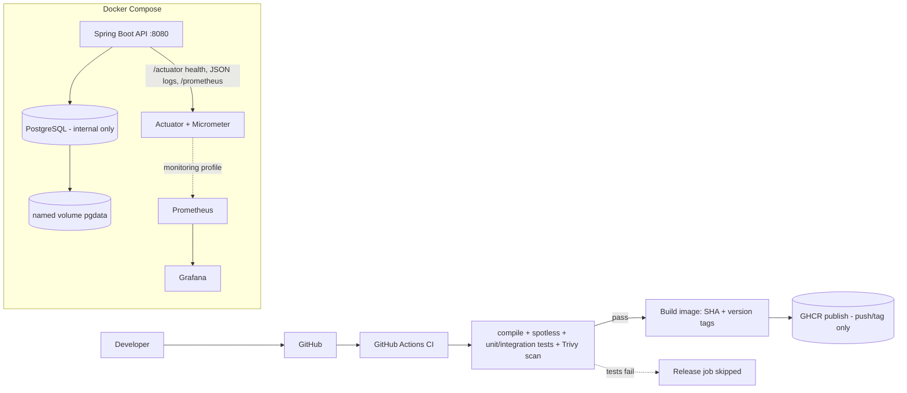

# Apex Operations API

[](https://github.com/hamido11/apex-operations-api/actions/workflows/ci.yml)

A small, production-minded operational service built for the Apex 48-hour DevOps assessment. It
demonstrates the full path from source to a safe, reproducible release: a containerized Java 21 /
Spring Boot REST API backed by PostgreSQL, with database migrations, health/readiness probes,
structured JSON logging, metrics, a gated CI/CD pipeline, versioned images, an executable
deploy/rollback flow, and an observability + troubleshooting story.

> Scope note: this targets the **Junior DevOps Engineer** brief (provided separately). The focus is
> DevOps quality and evidence, not application complexity. See
> [docs/decision-memo.md](docs/decision-memo.md) for why each "beyond-minimum" choice was made.

---

## Architecture summary



- **App**: Spring Boot 3.5 (Java 21), Spring MVC, Spring Data JPA, Bean Validation, Actuator.
- **DB**: PostgreSQL 16, schema owned by **Flyway** migrations.
- **Container**: multi-stage build, non-root, minimal JRE base pinned by digest, layered jar.
- **CI/CD**: GitHub Actions — validate → scan → (gated) publish to GHCR.
- **Ops**: `APP_IMAGE`-driven deploy/rollback scripts, smoke tests, controlled failure injection.
- **Observability**: structured JSON (ECS) logs with request correlation ids, Prometheus metrics,
  optional Prometheus + Grafana stack, alert rules.

Full detail: [docs/architecture.md](docs/architecture.md).

---

## Prerequisites

| Tool | Version used | Notes |
|---|---|---|
| macOS / Apple Silicon | 15.4, arm64 | Linux/AMD64 also supported (CI builds amd64) |
| Java | **21** (Temurin/OpenJDK) | build is pinned to 21 via the Maven Wrapper |
| Docker + Compose v2 | 29.x / v2 | Colima or Docker Desktop |
| Git | 2.x | |

GitHub CLI is **not** required. No paid cloud resources are used. All data is synthetic.

### Java 21 setup (macOS / Apple Silicon)

Java 21 is available via Homebrew:

```bash
brew install openjdk@21        # if not already installed
export JAVA_HOME="$(brew --prefix openjdk@21)/libexec/openjdk.jdk/Contents/Home"
java -version                  # expect: openjdk version "21.0.9"
```

The Maven Wrapper (`./mvnw`) pins Maven itself, and `pom.xml` sets `<release>21</release>`, so the
build is independent of whatever `java`/`mvn` is otherwise on your `PATH`.

---

## Quick start

```bash
# 1. Clone and enter the repo
git clone <this-repo-url> apex-operations-api && cd apex-operations-api

# 2. (optional) create a local env file; Compose also works with built-in defaults
cp .env.example .env

# 3. Build + run all tests (unit + Testcontainers integration tests; requires Docker running)
export JAVA_HOME="$(brew --prefix openjdk@21)/libexec/openjdk.jdk/Contents/Home"
./mvnw -B verify

# 4. Build the image and start the stack
docker build -t apex-operations-api:1.0.0 -t apex-operations-api:dev .
docker compose up -d --wait

# 5. Verify
curl -s localhost:8080/actuator/health/readiness
curl -s localhost:8080/api/v1/operations
```

> **Colima + Testcontainers**: if integration tests cannot reach Docker, export:
> ```bash
> export DOCKER_HOST="unix://$HOME/.colima/default/docker.sock"
> export TESTCONTAINERS_DOCKER_SOCKET_OVERRIDE="/var/run/docker.sock"
> ```

> **Port already in use?** Override host ports without editing anything:
> ```bash
> API_PORT=8081 PROMETHEUS_PORT=9091 GRAFANA_PORT=3001 docker compose up -d --wait
> ```

---

## Configuration

All configuration is externalized (environment variables); dev defaults live in
[`.env.example`](.env.example) and `application.yml`. **No real secrets are committed**; `.env` is
git-ignored.

| Variable | Default | Purpose |
|---|---|---|
| `POSTGRES_DB` / `POSTGRES_USER` / `POSTGRES_PASSWORD` | `apex` / `apex` / dev value | database credentials |
| `SPRING_DATASOURCE_URL/USERNAME/PASSWORD` | derived in Compose | app → DB connection |
| `APP_IMAGE` | `apex-operations-api:dev` | image the stack runs (deploy/rollback switch this) |
| `API_PORT` | `8080` | host port for the API |
| `APP_SIMULATE_FAILURE` | `false` | forces readiness DOWN (controlled rollback demo only) |
| `PROMETHEUS_PORT` / `GRAFANA_PORT` | `9090` / `3000` | monitoring profile host ports |
| `GRAFANA_USER` / `GRAFANA_PASSWORD` | `admin` / dev value | Grafana admin login |

---

## Build & test

```bash
./mvnw -B verify            # compile + unit + integration tests + package
./mvnw -B spotless:check    # lint / formatting gate (google-java-format)
./mvnw spotless:apply       # auto-format
./mvnw -B -Pfailure-gate test   # runs ONLY the intentional failing test (demo; expected to fail)
```

Automated checks (≥6, see [docs/assessment-evidence.md](docs/assessment-evidence.md)): service unit
test, REST API integration test, DB persistence integration test (Testcontainers + Flyway), health
endpoint test, readiness/dependency test, container non-root check, Compose config validation,
deployment smoke test — plus one **intentional** failing test used by the CI failure gate.

---

## API

| Method | Path | Description |
|---|---|---|
| GET | `/api/v1/operations` | list operations |
| GET | `/api/v1/operations/{id}` | get one (404 if missing) |
| POST | `/api/v1/operations` | create (validated; 201 + `Location`) |
| GET | `/actuator/health` | overall health |
| GET | `/actuator/health/liveness` | liveness probe |
| GET | `/actuator/health/readiness` | readiness probe (gated on DB) |
| GET | `/actuator/prometheus` | Prometheus metrics |

```bash
# Create
curl -i -X POST localhost:8080/api/v1/operations \
  -H 'Content-Type: application/json' \
  -d '{"name":"Deploy v1","status":"IN_PROGRESS","description":"demo","priority":2}'

# Validation error (RFC 7807 ProblemDetail)
curl -s -X POST localhost:8080/api/v1/operations \
  -H 'Content-Type: application/json' -d '{"name":"","status":"PENDING","priority":0}'
```

Every response carries an `X-Request-Id` correlation id that also appears as `traceId` in the logs.

---

## Health verification

```bash
curl -s localhost:8080/actuator/health            # {"status":"UP",...}
curl -s localhost:8080/actuator/health/readiness  # UP only when DB reachable
docker compose ps                                 # both services (healthy)
```

---

## CI/CD

GitHub Actions ([`.github/workflows/ci.yml`](.github/workflows/ci.yml)) runs three jobs:

1. **build-test** — Java 21, Maven cache, Spotless lint, `./mvnw verify`, upload test reports.
2. **image-scan** (`needs: build-test`) — build image (no push), **Trivy** image + dependency scan.
3. **publish** (`needs: build-test, image-scan`, push/tag only) — push multi-arch image to **GHCR**
   with immutable tags (`sha-<commit>`, version on tags, `latest` on releases).

**Release safety**: `publish` depends on the test/scan jobs, so **no image is published if tests
fail**. Pull requests run validation only (no publish credentials needed). A separate, manually
triggered workflow ([`failure-gate.yml`](.github/workflows/failure-gate.yml)) proves the gate: it
runs the intentional failing test and shows the dependent release job is **skipped**. Third-party
actions are pinned to commit SHAs; default permissions are `contents: read`.

---

## Release & rollback

Images are versioned and selected by `APP_IMAGE`. See
[docs/release-and-rollback.md](docs/release-and-rollback.md).

```bash
./scripts/deploy.sh   apex-operations-api:1.0.0   # deploy + verify health
./scripts/deploy.sh   apex-operations-api:2.0.0   # new version
./scripts/simulate-failure.sh                     # controlled bad release -> detected
./scripts/rollback.sh                             # back to previous good version, verified
```

Rollback restores the previous image and **only reports success if the recovered service passes
health/smoke checks** — it never fakes success.

---

## Observability

- Structured **JSON logs** (ECS) with `traceId` request correlation: `docker compose logs -f api`.
- **Metrics** at `/actuator/prometheus`.
- Optional stack: `docker compose --profile monitoring up -d` → Prometheus (`:9090`) scrapes the
  API, Grafana (`:3000`, admin/admin by default) with a provisioned dashboard; alert rules in
  [`monitoring/alerts.yml`](monitoring/alerts.yml). Proposal: [docs/architecture.md](docs/architecture.md#metrics--alerting-proposal).

---

## Security notes

Non-root container · base images pinned by digest · only port 8080 exposed · PostgreSQL on the
internal network only · env-based config with no committed secrets · `.env` git-ignored ·
least-privilege CI permissions · Trivy image + dependency scanning. Details and the cost-aware AWS
future path: [docs/security.md](docs/security.md).

---

## Troubleshooting & runbook

Operational procedures (deploy, rollback, DB recovery, incident response, log inspection) are in
[docs/runbook.md](docs/runbook.md); common issues in [docs/troubleshooting.md](docs/troubleshooting.md).

---

## Assumptions & trade-offs

- The API can be a small, documented service; a single `operations` entity is enough to exercise the
  DevOps path without unnecessary business logic.
- **v1 and v2 images are the same build tagged twice** — they demonstrate image-reference switching
  and rollback mechanics. The "bad release" is injected via `APP_SIMULATE_FAILURE` (a controlled,
  reversible readiness failure), which is honest and avoids shipping a real defect.
- Trivy gates the build on **fixable CRITICAL** OS/library vulnerabilities (dependency scan is
  report-only) to balance security signal against pipeline stability.
- Local secrets are plain dev defaults; production secret management is documented, not implemented.
- The Grafana/Prometheus stack is optional (behind a Compose profile) so the core release/rollback
  path has no extra dependencies.

---

## Known limitations

- No authentication/authorization on the API (out of scope for the assessment).
- `management.endpoint.health.show-details: always` is convenient for the demo; production should
  restrict it (documented in [docs/security.md](docs/security.md)).
- Image size (~400 MB) could be reduced further with a `jlink` custom runtime or distroless base.
- The AWS architecture is a documented future path only; nothing is deployed to any cloud.

---

## Repository layout

```
.github/workflows/   ci.yml, failure-gate.yml
src/                 application + tests
scripts/             deploy, rollback, smoke-test, simulate-failure, check-nonroot, validate-compose
monitoring/          prometheus.yml, alerts.yml, grafana provisioning
docs/                architecture, runbook, security, troubleshooting, release-and-rollback,
                     decision-memo, ai-disclosure, assessment-evidence
evidence/            genuine captured outputs (sanitized)
Dockerfile  compose.yaml  .dockerignore  .gitignore  .env.example  pom.xml
```
