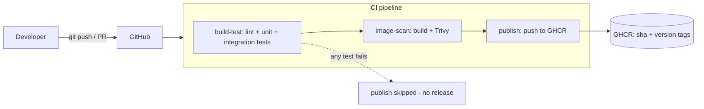
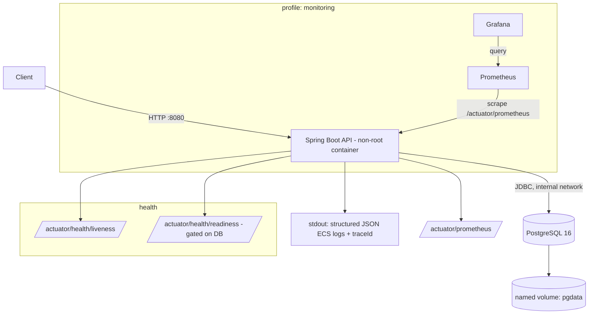

# Architecture

## Overview

The Apex Operations API is a single Spring Boot service persisting operational records to
PostgreSQL. It is packaged as a non-root container and run locally via Docker Compose. CI/CD runs on
GitHub Actions and publishes versioned images to GHCR.

## Delivery pipeline (source → release)



- Pull requests run `build-test` + `image-scan` only (no publish, no credentials needed).
- `publish` runs only on pushes to `main` / version tags and **depends on** the prior jobs, so a
  failed test or scan blocks the release.

## Local runtime



- **Network**: a single user-defined bridge network (`backend`). PostgreSQL's port is **not
  published** to the host — the DB is reachable only by the API.
- **Persistence**: a named volume (`pgdata`) survives container recreation.
- **Startup ordering**: the API `depends_on` the DB with `condition: service_healthy`
  (`pg_isready`); the API's own container healthcheck targets the readiness probe.

## Application structure

```
com.apex.operations
├── ApexOperationsApiApplication   # entry point
├── domain/        Operation (entity), OperationStatus (enum)
├── repository/    OperationRepository (Spring Data JPA)
├── service/       OperationService, OperationNotFoundException
├── web/           OperationController, dto/, GlobalExceptionHandler (RFC 7807), CorrelationIdFilter
├── health/        SimulatedFailureHealthIndicator (readiness group)
└── config/        AppProperties
```

- **Migrations**: Flyway `V1__init_operations.sql` (schema + synthetic seed) and
  `V2__add_operations_priority.sql` (backward-compatible additive column). JPA runs with
  `ddl-auto: validate` — it never generates DDL.
- **Config & timeouts**: externalized via env; HikariCP connection timeout (10s), JPA query timeout
  (5s), Tomcat connection timeout (20s), graceful shutdown (20s).
- **Error handling**: `@RestControllerAdvice` returns RFC 7807 `ProblemDetail` for validation (400),
  not-found (404), unreadable body (400), and a generic 500 that never leaks internals.
- **Correlation**: `CorrelationIdFilter` assigns/propagates `X-Request-Id`, placed on the MDC as
  `traceId` and included in every structured log line.

## Observability

- **Logs**: Spring Boot native structured logging (`logging.structured.format.console=ecs`) — one
  JSON object per line, including `traceId`, logger, level, and `service.version`.
- **Health**: Actuator `health`, `health/liveness`, `health/readiness`. The readiness group includes
  `readinessState`, `db`, and `simulatedFailure`, so readiness reflects real dependency state.
- **Metrics**: Micrometer + Prometheus registry at `/actuator/prometheus`.

### Metrics & alerting proposal

Concrete alert rules are implemented in [`../monitoring/alerts.yml`](../monitoring/alerts.yml).

| Metric | Source (Micrometer) | Why it matters | Example alert |
|---|---|---|---|
| Request rate | `http_server_requests_seconds_count` | traffic / capacity baseline | — (dashboard) |
| HTTP 5xx error rate | same, `status=~"5.."` | user-facing failures | > 5% for 5m (warning) |
| Request latency p95 | `http_server_requests_seconds_bucket` | performance regressions | p95 > 1s for 5m (warning) |
| JVM heap usage | `jvm_memory_used_bytes` / `_max` | OOM / GC pressure risk | > 90% for 10m (warning) |
| CPU usage | `process_cpu_usage` | saturation | > 85% for 10m (warning) |
| DB pool usage | `hikaricp_connections_active` / `_max` | connection exhaustion | active ≥ max for 2m (warning) |
| DB availability | readiness probe / scrape failure | hard dependency down | instance `up == 0` 1m (critical) |
| Container restarts | orchestrator (ECS/K8s) or `docker events` | crash loops | > N in 10m (warning) |

In production these feed Alertmanager (or CloudWatch Alarms on the AWS path); locally they are
visible in the Prometheus UI. A direct PostgreSQL metric (via `postgres_exporter`) would strengthen
DB availability alerting beyond the API's own readiness signal.
