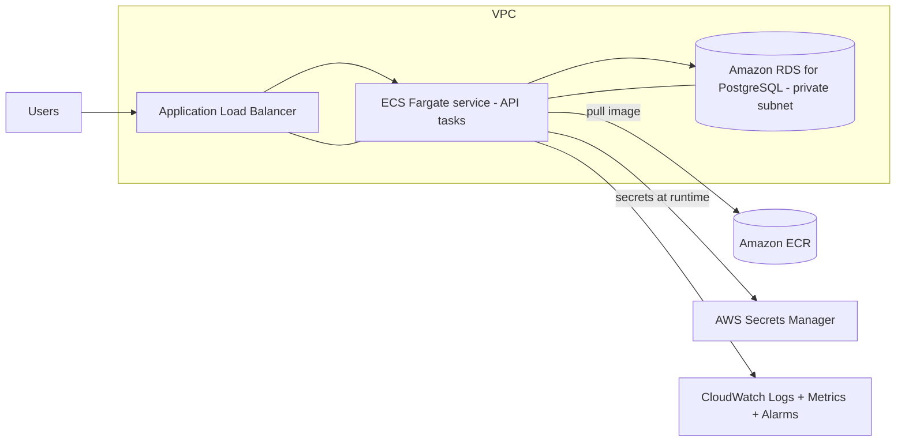

# Security

Security is treated as an engineering requirement, not an afterthought. This documents the controls
implemented in the project and the recommended production hardening.

## Implemented controls

| # | Control | Where / how |
|---|---|---|
| 1 | Non-root container execution | `Dockerfile` creates user `apex` (uid 10001); `USER 10001:10001`. Verified by `scripts/check-nonroot.sh`. |
| 2 | Environment-based configuration | `application.yml` reads `${SPRING_DATASOURCE_*}`, `${APP_*}`; Compose injects via env. |
| 3 | No hardcoded credentials | Only dev defaults (clearly labelled) in `.env.example`/`application.yml`; no real secrets committed. |
| 4 | Git ignore rules for secrets | `.gitignore` excludes `.env` and `.env.*` (keeps `.env.example`), logs, build output. |
| 5 | Least-privilege CI permissions | `ci.yml` top-level `permissions: contents: read`; only `publish` adds `packages: write`. |
| 6 | Dependency vulnerability scanning | Trivy filesystem scan (`scan-type: fs`) over the repo in CI. |
| 7 | Image vulnerability scanning | Trivy image scan in CI; fails on fixable CRITICAL (OS + libraries). |
| 8 | Base image selection & pinning | `eclipse-temurin:21-jre-alpine` + `maven:3.9-eclipse-temurin-21`, both pinned by **digest**. |
| 9 | Minimal exposed ports | Only the API's `8080` is published; nothing else by default. |
| 10 | DB restricted to internal network | PostgreSQL is on the `backend` network with **no host port published**. |
| 11 | Safe log handling | Structured logs contain no secrets/PII; errors log server-side, clients get generic messages. |
| 12 | Secret management guidance | Dev vs prod separation documented below. |

## Local development secrets vs production secrets

- **Local/dev**: `.env` (git-ignored) or Compose defaults. Values like `POSTGRES_PASSWORD` are
  throwaway and never represent real credentials. `.env.example` ships only placeholders.
- **Production**: credentials must come from a managed secret store (e.g., **AWS Secrets Manager** or
  SSM Parameter Store), injected at runtime as environment variables or mounted files — never baked
  into the image, Compose file, or VCS. Rotate regularly; scope DB users to least privilege;
  restrict `management.endpoint.health.show-details` to `when-authorized`.

## Supply-chain / reproducibility

- Base images pinned by immutable digest; Maven pinned via the wrapper.
- Third-party GitHub Actions pinned to commit SHAs (not mutable tags).
- Published images are tagged with the immutable commit SHA (plus semantic version on releases);
  `latest` is only added on tagged releases, never relied upon for deploys.

## Cost-aware future cloud architecture (AWS) — documented, not deployed

- **Compute**: ECS on **Fargate** (no servers to manage; scale to zero-ish for cost). Start with
  Fargate Spot for non-critical environments.
- **Registry**: **ECR** (the CI already produces multi-arch images; swap GHCR login for ECR login).
- **Database**: **RDS for PostgreSQL** in **private subnets**, Multi-AZ only when justified by cost.
- **Secrets**: **Secrets Manager** (or SSM Parameter Store for cheaper static config); injected into
  task definitions, never in the image.
- **Networking**: **VPC** with public subnets for the ALB and private subnets for ECS + RDS;
  security groups allow only ALB→API→RDS on required ports.
- **Observability**: **CloudWatch** Logs (JSON logs ingest cleanly), container metrics, and Alarms
  mirroring [`../monitoring/alerts.yml`](../monitoring/alerts.yml).
- **IAM**: task execution role (pull image, read secrets) separate from the task role (app runtime);
  least privilege throughout.

Cost controls: single-AZ + Fargate Spot in dev, right-sized task CPU/memory, log retention limits,
and scale-in policies. Nothing in this section is deployed as part of the assessment.

## Critical red flags — explicitly avoided

- No hardcoded secrets or exposed sensitive env vars (dev defaults are clearly labelled, git-ignored
  for real values).
- No claimed success without evidence — see [assessment-evidence.md](assessment-evidence.md); any
  unexecuted item is marked **NOT VERIFIED**.
- Reproducible: Maven wrapper + pinned images + a clone-and-run README.
